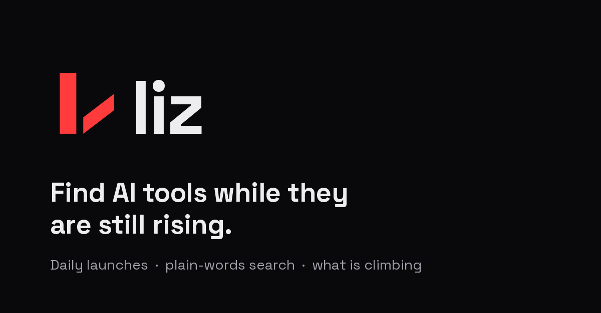

# Liz

**Discover the next big AI tool before everyone else.**

Liz is a web application for finding AI tools while they are still rising. It
collects new launches from Product Hunt, Hacker News and GitHub, decides which
are worth showing, summarises them, ranks them by measured growth, and lets
people search in plain language, follow tools and hear when something changes.
It also analyses GitHub repositories and explains how they were built.

Live at <https://liz-cfp.pages.dev> (sign-in required).



Licensed under the [Apache License 2.0](LICENSE).

---

## Contents

- [Why Liz](#why-liz)
- [Features](#features)
- [Architecture](#architecture)
- [Technology](#technology)
- [Repository structure](#repository-structure)
- [Getting started](#getting-started)
- [Local development](#local-development)
- [Configuration](#configuration)
- [Database](#database)
- [Testing](#testing)
- [Building and deploying](#building-and-deploying)
- [Documentation](#documentation)
- [Deliberate decisions](#deliberate-decisions)
- [Known limitations](#known-limitations)
- [Contributing](#contributing)
- [Security](#security)
- [Licence](#licence)
- [Acknowledgements](#acknowledgements)

## Why Liz

New AI tools launch every day, and the lists that track them rank by fame:
total stars, total votes, how long a tool has existed. By the time a tool
tops those lists everyone already knows it. Liz ranks by growth instead. It
records each tool's signals every day and shows what is rising now, with the
reason in words ("227 points on Hacker News"). Nothing shown is estimated
or seeded.

## Features

- **Discover**: the catalog ranked by growth over the last seven days, filtered
  by category and price, with a "For you" shelf from the categories a person
  follows.
- **Ask Liz**: describe what you need in plain words and get the tools that fit,
  found by semantic search over open-source embeddings.
- **Tool pages**: summary, pricing, a signal line of recorded history, a
  timeline (first seen, launches, price changes), related news, alternatives,
  side-by-side comparison, reviews, and an embeddable "Listed on Liz" badge.
- **News**: an hourly technology feed with short summaries, linked to the
  tools it names.
- **Saved and Alerts**: saving a tool watches it. Price changes and rises arrive
  in Alerts, in the app and as browser push notifications.
- **Repository Analyzer**: paste a GitHub repository (HTTPS, SSH or
  `gh repo clone`) and get its stack, architecture diagrams, data model, API,
  build and deployment, security and quality, and ask questions answered from
  its own files with path and line ([docs/REPO_ANALYZER.md](docs/REPO_ANALYZER.md)).
- **Self-maintaining catalog**: scheduled scrapers, a quality gate that records
  why anything is held back, malware and phishing screening, and an admin
  console for moderation and health.
- **Accounts**: email and password or Google sign-in (Firebase
  Authentication), password reset, two-step verification for admins, and
  account deletion.

## Architecture

```
                ┌──────────────────────────────┐
  Browser ─────▶│ Flutter web app (CanvasKit)  │  Cloudflare Pages
                └──────┬───────────────┬───────┘
          Firebase ID  │               │ supabase-js (anon key + RLS)
          token        ▼               ▼
            ┌─────────────────┐  ┌─────────────────────────────────────┐
            │ Firebase Auth   │  │ Supabase                            │
            │ (who you are)   │  │  Postgres + pgvector, row-level     │
            └─────────────────┘  │  security on every table            │
                                 │  Edge Functions (Deno): Ask Liz,    │
                                 │  summaries, news, repo analysis,    │
                                 │  push, ingestion                    │
                                 │  pg_cron: fetch, embed, rank, health│
                                 └──────▲──────────────────────▲───────┘
                                        │ service role         │ ingest key
                     GitHub Actions ────┘                      └──── n8n (home)
                     Python scraper, backups, deploys             Python scraper
```

Firebase handles identity only. Everything else lives in Postgres, which
trusts Firebase ID tokens as a third-party auth provider
([docs/AUTH.md](docs/AUTH.md)). The data flow from launch to published tool is
in [docs/CATALOG_PIPELINE.md](docs/CATALOG_PIPELINE.md), and the schema in
[docs/DATA_ARCHITECTURE.md](docs/DATA_ARCHITECTURE.md).

## Technology

| Layer | Technology |
| --- | --- |
| App | Flutter 3.47 (web), Dart 3.12, Riverpod, go_router |
| Identity | Firebase Authentication |
| Data | Supabase: Postgres, pgvector, row-level security, pg_cron, Storage |
| Server code | Supabase Edge Functions (Deno, TypeScript) |
| Search | `gte-small` embeddings computed inside Supabase |
| Summaries | Open models through an OpenAI-compatible API (Groq's free tier by default) |
| Scraping | Python 3.12, requests, BeautifulSoup, lxml |
| Scheduling | pg_cron, GitHub Actions, self-hosted n8n |
| Hosting | Cloudflare Pages (with a Pages Function relaying Firebase sign-in) |
| Push | Firebase Cloud Messaging |

## Repository structure

```
lib/                    Flutter web app
  app/                  router, theme, responsive shell
  core/                 auth, config, repositories (mock and Supabase), telemetry
  features/             discover, ask_liz, tool_detail, news, alerts, track,
                        compare, repo_analyzer, profile, auth, onboarding,
                        legal, admin, community (built, hidden from navigation)
  shared/               models and widgets
shaders/                fragment shader for the ambient light
assets/                 fonts, icons, illustrations
web/                    index.html, headers, service worker, icons
functions/              Cloudflare Pages Function (Firebase sign-in relay)
supabase/
  migrations/           schema, RLS policies, triggers, cron jobs, health checks
  functions/            Edge Functions and their tests
  seed*.sql             demo content for a local database
scrapers/               Python scraper, quality gate, maintenance scripts
n8n/                    workflow for running the scraper from a home connection
tool/                   CI script, browser QA, brand tooling, git hooks
test/                   Flutter tests
docs/                   how each part works
```

## Getting started

### Prerequisites

- [Flutter](https://docs.flutter.dev/get-started/install) 3.47.2 (stable), with Chrome
- Optional, for the backend: [Supabase CLI](https://supabase.com/docs/guides/cli)
  and Docker, [Deno](https://deno.com) 2.x, Python 3.12

### Run it with demo data (no accounts, no keys)

```bash
git clone https://github.com/jeswinbenedict/LIZ.git
cd LIZ
flutter pub get
flutter run -d chrome
```

Without Supabase settings the app uses a bundled dataset and a mock backend,
so every screen works offline. Sign in with any email and password: the demo
account is an admin, so the admin console is reachable too.

## Local development

To run against a real backend, use your own Supabase project, either local or
hosted. Never point a development build at someone else's production project.

1. **Database.** For a local stack: `supabase start`, then `supabase db reset`
   to apply every migration and `supabase/seed.sql`. For a hosted project:
   `supabase link --project-ref <ref>` and `supabase db push`.
2. **Edge Functions.** Copy `supabase/functions/.env.example` to
   `supabase/functions/.env`, fill in what you need, then
   `supabase functions serve --env-file supabase/functions/.env`.
3. **App.** Copy `.env.example` to `.env`, set `SUPABASE_URL` and
   `SUPABASE_ANON_KEY`, then:

   ```bash
   flutter run -d chrome --dart-define-from-file=.env
   ```

   `run_web.ps1`, `.vscode/launch.json` and `.claude/launch.json` do the same.
4. **Sign-in.** Live mode signs in through Firebase. The Firebase web
   configuration is in `lib/core/firebase/firebase_app.dart` and names the
   maintainer's project. For your own deployment, create a Firebase project,
   replace that configuration and the project ID in `supabase/config.toml`
   (`[auth.third_party.firebase]`), and follow [docs/AUTH.md](docs/AUTH.md).
5. **Scraper (optional).** `pip install -r scrapers/requirements.txt`, set the
   variables in `scrapers/.env.example`, then from `scrapers/`:
   `python -m liz_scraper --source hackernews --dry-run --limit 20`.

## Configuration

| File | What it configures | Contains secrets |
| --- | --- | --- |
| `.env` (from `.env.example`) | The web build: Supabase URL and anon key, Web Push key, legal contact | No. Only public client values, since they are compiled into the bundle |
| `supabase/functions/.env` (from its `.env.example`) | Edge Functions: AI provider, Firebase Admin key, ingest key | Yes |
| `scrapers/.env` (from its `.env.example`) | Scraper: service-role key or ingest key, GitHub token | Yes |
| GitHub Actions secrets | Deploys, scheduled scrapes and backups | Yes |

The Supabase anon key and the Firebase web configuration are public by design:
they identify the project and grant nothing on their own, and every table is
protected by row-level security. Every secret, where it is set and what uses
it is listed in [docs/OPERATIONS.md](docs/OPERATIONS.md#8-secrets).

## Database

`supabase/migrations/` holds 64 numbered migrations: the schema, row-level
security policies, triggers, pg_cron jobs, ranking and health checks. They are
applied in order by `supabase db reset` locally and `supabase db push` against
a hosted project. In this repository's deployment, `deploy-supabase.yml`
applies them on every push to `main` that changes `supabase/`.

`supabase/seed.sql` mirrors the app's bundled demo catalog, so a fresh local
database is browsable. A new schema change is always a new migration file,
never an edit to an applied one.

## Testing

```bash
flutter analyze                                            # clean at every level
flutter test                                               # app
cd scrapers && python -m pytest tests                      # scraper
ruff check scrapers tool --config scrapers/pyproject.toml  # Python lint
deno test --allow-env --no-check supabase/functions/tests  # Edge Functions
bash tool/ci_local.sh                                      # all of CI, locally
```

CI runs all of these on every push and pull request, along with a type check
of every Edge Function, every migration applied to a fresh database with its
schema and policies checked, a secret scan and a dependency vulnerability
check. `test/screen_sweep_test.dart` puts every
screen through a 320-pixel phone, 1.5× text and a tablet, and through
Flutter's accessibility guidelines. In a real browser,
[`tool/qa`](tool/qa/README.md) walks 14 visitor journeys and audits every
page's accessibility tree at desktop and phone widths.

`python -m liz_scraper.eval_ask` evaluates Ask Liz on 60 questions against a
live project and is not run in CI.

## Building and deploying

```bash
flutter build web --release --dart-define-from-file=.env
```

The output is in `build/web`. Any static host works. The repository's own
deployment uses three workflows:

| Workflow | Does |
| --- | --- |
| `ci.yml` | lint, type checks, tests, browser checks, secret and vulnerability scans |
| `deploy-web.yml` | builds and publishes to Cloudflare Pages after CI passes on `main`, and daily |
| `deploy-supabase.yml` | applies migrations and deploys Edge Functions when `supabase/` changes |

The scheduled workflows (`scrape-tools`, `fetch-news`, `backup-db`) and the
secrets each one needs are described in [docs/OPERATIONS.md](docs/OPERATIONS.md).
In a fork, workflows that need secrets skip their work with a warning until
the secrets are set.

## Documentation

| Guide | Covers |
| --- | --- |
| [AUTH.md](docs/AUTH.md) | Firebase Authentication in front of Supabase |
| [CATALOG_PIPELINE.md](docs/CATALOG_PIPELINE.md) | scraping, the quality gate, publishing |
| [DATA_ARCHITECTURE.md](docs/DATA_ARCHITECTURE.md) | the schema and where data lives |
| [RANKING.md](docs/RANKING.md) | how "Rising" is calculated |
| [REPO_ANALYZER.md](docs/REPO_ANALYZER.md) | the Repository Analyzer and its API |
| [OPERATIONS.md](docs/OPERATIONS.md) | alerts, crash reports, backups, deploys, scheduled jobs, secrets |
| [SECURITY.md](docs/SECURITY.md) | the security model and what was found and fixed |
| [DESIGN.md](docs/DESIGN.md) | the design system |
| [FCM_SETUP.md](docs/FCM_SETUP.md) | browser push notifications |
| [WEB_BUILD.md](docs/WEB_BUILD.md) | the web build and its headers |
| [SEO.md](docs/SEO.md) | link previews, and the pre-renderer (switched off) |

The Edge Functions' request and response shapes are documented beside each
function in `supabase/functions/` and, for the Repository Analyzer, in
[docs/REPO_ANALYZER.md](docs/REPO_ANALYZER.md).

## Deliberate decisions

- **Web first.** The Android and iOS scaffolds were removed rather than carried
  unbuilt. `flutter create --platforms android,ios .` restores them; re-enable
  the platform keys in `pubspec.yaml` for icons and splash at the same time.
- **Signed-in only.** Since 5 October 2026 the catalog is readable only by
  signed-in people (migration 0061), so pages are not pre-rendered for search
  engines.
- **No paid AI APIs.** Semantic search is embeddings in the database, and
  summaries use free open models.
- **Community is built but hidden.** Posts, comments and their moderation work
  and are tested, but are left out of navigation until there is an audience.
  Adding it back is one entry in `kNavDestinations`.

## Known limitations

- **Product Hunt** blocks data-centre addresses, so its launches only resolve
  when the scraper runs from a home connection (the n8n workflow,
  [n8n/README.md](n8n/README.md)).
- **Firebase configuration is in source** (`lib/core/firebase/firebase_app.dart`)
  rather than in `.env`. A fork that wants live sign-in must replace it.
- **The privacy policy and terms** (`/privacy`, `/terms`) were written from
  the code, not by a lawyer.
- **No versioned releases.** `main` is what is deployed
  ([CHANGELOG.md](CHANGELOG.md)).
- **Mobile apps** are not built (see "Web first").

## Contributing

Contributions are welcome. Read [CONTRIBUTING.md](CONTRIBUTING.md) for setup,
the checks and the conventions, and follow the
[Code of Conduct](CODE_OF_CONDUCT.md). For help, see [SUPPORT.md](SUPPORT.md).

## Security

Please report vulnerabilities privately, as described in
[SECURITY.md](SECURITY.md), and never in a public issue.

## Licence

Copyright 2026 Jeswin Benedict. Licensed under the
[Apache License, Version 2.0](LICENSE); see [NOTICE](NOTICE).

Third-party packages, fonts and trademarks keep their own licences and are not
covered by this project's licence. They are listed in
[THIRD_PARTY_LICENSES.md](THIRD_PARTY_LICENSES.md).

## Acknowledgements

- [Flutter](https://flutter.dev), [Supabase](https://supabase.com) and
  [Firebase](https://firebase.google.com), on whose free tiers Liz runs.
- [Space Grotesk](https://github.com/floriankarsten/space-grotesk) and
  [JetBrains Mono](https://github.com/JetBrains/JetBrainsMono), under the SIL
  Open Font License.
- `gte-small` for embeddings, and open models served by [Groq](https://groq.com).
- Hacker News, Product Hunt and GitHub, whose public data fills the catalog.
- [URLhaus](https://urlhaus.abuse.ch), OpenPhish, PhishTank and PhishStats,
  whose lists screen every listed site.
